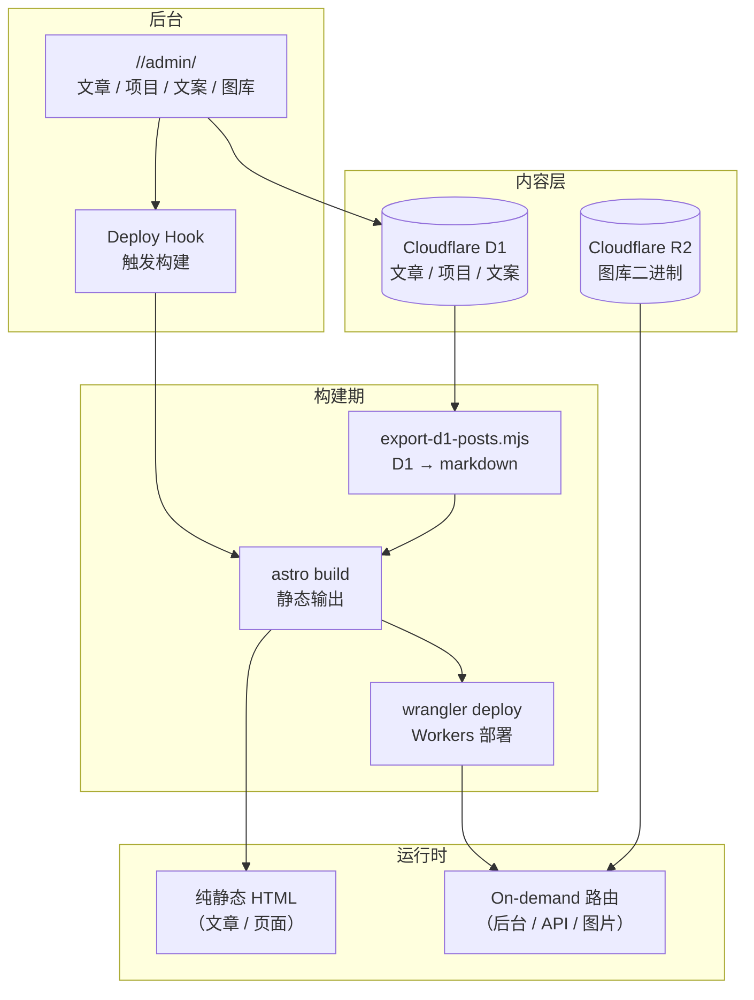

<a id="readme-top"></a>

# Meovo

[![Astro 7][astro-shield]][astro-url]
[![Cloudflare Workers][cf-shield]][cf-url]
[![TypeScript 5][ts-shield]][ts-url]
[![pnpm][pnpm-shield]][pnpm-url]
[![MIT License][license-shield]][license-url]

> 个人博客 —— Astro 7 静态站 + Cloudflare Workers，中英双语，后台自建。
> 内容存在 D1 里，构建时导出成静态文件；部署出去的是纯静态 HTML，运行时不碰数据库。

**在线服务**：[https://example.com][site-url] · **仓库**：[ikaraseay/meovo][repo-url]

<details>
<summary><strong>目录</strong></summary>

<ol>
  <li><a href="#about">项目简介</a></li>
  <li><a href="#features">核心特性</a></li>
  <li><a href="#built-with">技术栈</a></li>
  <li><a href="#architecture">系统架构</a></li>
  <li><a href="#getting-started">快速开始</a>
    <ul>
      <li><a href="#prerequisites">前置条件</a></li>
      <li><a href="#installation">本地安装</a></li>
      <li><a href="#commands">常用命令</a></li>
    </ul>
  </li>
  <li><a href="#deployment">生产部署</a></li>
  <li><a href="#configuration">配置说明</a></li>
  <li><a href="#structure">目录结构</a></li>
  <li><a href="#content-system">内容系统</a></li>
  <li><a href="#liquid-glass">液态玻璃主题</a></li>
  <li><a href="#i18n">国际化</a></li>
  <li><a href="#faq">常见问题</a></li>
  <li><a href="#roadmap">路线图</a></li>
  <li><a href="#contributing">贡献指南</a></li>
  <li><a href="#license">许可证</a></li>
  <li><a href="#acknowledgments">致谢</a></li>
</ol>

</details>

<p align="right">(<a href="#readme-top">返回顶部</a>)</p>

---

<a id="about"></a>

## 项目简介

Meovo 是一个中英双语的个人博客，采用静态生成 + 运行时 Worker 的混合架构：

- **前台纯静态**：页面在构建期就渲染好了，**运行时不查 D1** —— D1 只服务后台与构建流程；
- **内容即数据**：后台（D1）写稿，构建期导出 markdown + 文案覆盖 + 项目清单；
- **双语对称**：`/zh/` 与 `/en/` 对称路由；同 slug 的两个文件互为翻译，缺一版时另一版顶上并标注；
- **自建后台**：`/<lang>/admin/` —— 文章 / 项目 / 界面文案 / 图库，单管理员，一个口令；
- **液态玻璃主题**：卡片画布 + 折射玻璃 + 明暗跟随系统；
- **纯静态搜索**：归档页内联一份索引，浏览器端匹配 + 高亮；
- **零工具类**：样式是原生 CSS + `--ui-*` token 契约，没有 Tailwind、没有 UI 库。

<p align="right">(<a href="#readme-top">返回顶部</a>)</p>

<a id="features"></a>

## 核心特性

### 内容管理

- **D1 驱动**：文章、项目、界面文案都存在 Cloudflare D1，后台改完一键构建上线；
- **构建期导出**：`pnpm build` 自动从 D1 拉取内容，生成 markdown 文件，静态输出纯 HTML；
- **发布 ≠ 上线**：后台只改数据库，站点要等下一次构建（手动或 Deploy Hook 触发）；
- **图库管理**：图片二进制进 R2，元数据进 D1，公开地址 `/media/<key>` 带 uuid 永久缓存；
- **完整性闸门**：导出脚本检测「上次有文章、这次一篇都没有」的异常情况，防止误操作上线空站。

### 用户体验

- **液态玻璃 UI**：可拖拽的玻璃卡片桌面，支持固定、摆位、倾斜；导航栏是真折射（Chromium）或降级毛玻璃；
- **明暗模式**：跟随系统偏好，首屏前同步判定，不闪；
- **中英双语**：同一篇文章的多个语言版本共用 slug，缺一版时自动回退并标注；
- **纯静态搜索**：归档页内联索引，浏览器端匹配 + 高亮，支持中文逐字切分；
- **无障碍**：强化焦点环、始终显示链接下划线、更大点击目标，三档可选；
- **相对字号与行距**：滑块调节，全站跟随，偏好存 localStorage。

### 技术特性

- **零工具类 CSS**：原生 CSS + `--ui-*` token 契约，结构刻度与语义色层分离；
- **DOM 契约**：跨 module 的 class 名 / data 属性名 / 层级刻度统一在 `dom-contract.ts`；
- **动效系统**：三层（刻度 / 原语 / 归零），只听系统 `prefers-reduced-motion`；
- **纯静态 SEO**：canonical / hreflang / OG / Twitter / JSON-LD / sitemap / RSS 全部构建期生成；
- **测试守卫**：单元测试（`node --test`）+ i18n 完整性 + SEO 一致性 + DOM 契约双向检查。

<p align="right">(<a href="#readme-top">返回顶部</a>)</p>

<a id="built-with"></a>

## 技术栈

| 层 | 技术 |
|---|---|
| 框架 | Astro 7 · 静态输出 + `@astrojs/cloudflare` 适配器 |
| 运行时 | Cloudflare Workers · 静态资源与接口一次部署，同域无跨域 |
| 数据库 | Cloudflare D1（SQLite）· 文章、项目、文案覆盖 |
| 对象存储 | Cloudflare R2 · 图库二进制（`/media/<key>` 公开可永久缓存） |
| 样式 | 原生 CSS + `--ui-*` token · 结构刻度（tokens.css）与语义色层（主题文件）分开 |
| 包管理 | pnpm · Node 钉在 `.node-version` |
| 测试 | `node --test` · 纯 module 直接 import，零测试框架 |
| 部署 | Cloudflare Workers Builds · push 自动构建 + 部署 |

<p align="right">(<a href="#readme-top">返回顶部</a>)</p>

<a id="architecture"></a>

## 系统架构



**数据流**：后台改 D1 → 构建期导出 markdown → Astro 静态输出 → 部署到 Workers → 运行时纯静态，不碰数据库。

<p align="right">(<a href="#readme-top">返回顶部</a>)</p>

---

<a id="getting-started"></a>

## 快速开始

<a id="prerequisites"></a>

### 前置条件

| 项 | 要求 |
|---|---|
| Node.js | ≥ 22.23（`.node-version` 写的 22.23.4） |
| pnpm | 12+（`package.json` 的 `packageManager` 钉版本） |
| Cloudflare 账号 | D1 / R2 / Workers（免费额度足够个人博客） |
| wrangler CLI | 已登录（`pnpm wrangler login`） |

<a id="installation"></a>

### 本地安装

```bash
git clone https://github.com/ikaraseay/meovo.git
cd meovo

pnpm install
cp config.env.example config.env    # 填站点地址 / 库 id / 桶名（注释里写了怎么拿）
pnpm sync                          # 从 D1 拉内容（文章 / 文案 / 项目）到本地
pnpm dev                           # 开发服务器
```

`pnpm sync` 需要能访问 D1：有 `CLOUDFLARE_API_TOKEN` 就走 REST，没有就借 wrangler 的登录态（`wrangler login` 过即可）。

`config.env` 是**唯一**要改环境值的地方（不入库）。仓库里的 `cloudflare/wrangler.jsonc` 与 `astro.config.mjs` 放的是占位符，构建前由 `scripts/apply-config.mjs` 把真值填回去。

<a id="commands"></a>

### 常用命令

```bash
pnpm dev              # 开发服务器
pnpm build            # 构建（先跑导出）
pnpm preview          # 预览构建产物
pnpm check            # 类型检查（astro check）
pnpm test             # 单元测试
pnpm check:i18n       # 语言包完整性 + 硬编码文案扫描
pnpm check:seo        # canonical / hreflang / sitemap / RSS 一致性
pnpm sync             # 从 D1 拉最新内容到本地
pnpm clean            # 清掉本地的内容副本（本地不留文章）
pnpm ops              # 运维脚本：doctor / config / env / login / status
pnpm run deploy       # 部署到 Cloudflare Workers
```

<p align="right">(<a href="#readme-top">返回顶部</a>)</p>

<a id="deployment"></a>

## 生产部署

部署只有一条路径：**[Cloudflare Workers Builds](https://developers.cloudflare.com/workers/ci-cd/builds/)** 直连 GitHub 仓库 —— push 自动构建 + 部署；内容改动走 Deploy Hook。

### 1. Cloudflare 资源准备

```bash
# 创建 D1 数据库
pnpm wrangler d1 create meovo-content
# 返回的 database_id 填进 config.env 的 D1_DATABASE_ID

# 创建 R2 存储桶
pnpm wrangler r2 bucket create meovo-media
# 桶名填进 config.env 的 R2_BUCKET_NAME

# 初始化数据库表
pnpm wrangler d1 execute meovo-content --remote --file=backend/db/migrations/0001_initial.sql
pnpm wrangler d1 execute meovo-content --remote --file=backend/db/migrations/0002_settings.sql
pnpm wrangler d1 execute meovo-content --remote --file=backend/db/migrations/0003_comments.sql
pnpm wrangler d1 execute meovo-content --remote --file=backend/db/migrations/0004_projects.sql
```

### 2. Workers Builds 配置

Dashboard → Worker → **Settings → Builds → Connect to Git**：

| 字段 | 值 |
|---|---|
| Root directory | `/` |
| Build command | `pnpm install --frozen-lockfile && pnpm build` |
| Deploy command | `pnpm run deploy` |
| Build variables | `WORKER_NAME` · `SITE_URL` · `D1_DATABASE_NAME` · `D1_DATABASE_ID` · `R2_BUCKET_NAME` · `CLOUDFLARE_ACCOUNT_ID` |

**构建 token 要带 D1 权限**：Worker Settings → Builds → API token 那支 token 默认只有 Workers Scripts / KV / R2 / Routes，**没有 D1** —— 而 `pnpm build` 的第一步就是从 D1 导出内容。不换 token 的话导出会失败（Workers Builds 注入 `WORKERS_CI=1`，导出脚本据此把「必须导出成功」打开）。

### 3. Worker Secrets

```bash
# 后台口令（SHA-256）
pnpm wrangler secret put ADMIN_PASSWORD_HASH --config cloudflare/wrangler.jsonc

# 会话密钥
pnpm wrangler secret put SESSION_SECRET --config cloudflare/wrangler.jsonc

# Deploy Hook（可选，用于后台触发构建）
pnpm wrangler secret put DEPLOY_HOOK_URL --config cloudflare/wrangler.jsonc
```

### 4. 后台改内容怎么触发构建

D1 不在 git 里，push 永远不会发生。去 **Settings → Builds → Deploy Hooks** 建一个 hook（branch = `main`），把 URL 存成 Worker secret。这样就不需要把任何 Cloudflare 凭证放进 GitHub（GitHub 上只有代码）。

`.github/workflows/ci.yml` 只跑检查，不部署、不需要 secret。不想接 Git 的话，`pnpm sync && pnpm build && pnpm run deploy` 手动走一遍也一样。

<p align="right">(<a href="#readme-top">返回顶部</a>)</p>

<a id="configuration"></a>

## 配置说明

| 文件 | 作用 | 入库 |
|---|---|---|
| `config.env` | 环境值唯一事实源（站点地址 / 库 id / 桶名 / 本地凭据） | 否 |
| `config/site.json` | 站点文案默认值（站名 / 笔名 / 邮箱 / 标语） | 是 |
| `cloudflare/wrangler.jsonc` | Worker 绑定声明（占位符，构建前填充） | 是 |
| `astro.config.mjs` | Astro 配置（占位符，构建前填充） | 是 |
| `cloudflare/.dev.vars` | 本地 secret（跟 wrangler 配置同目录） | 否 |

**仓库是模版**：`cloudflare/wrangler.jsonc` 与 `astro.config.mjs` 里是占位符（库 id / 桶名 / 域名），真值在 `config.env`（不入库），构建前由 `scripts/apply-config.mjs` 填回去。

本地这两个文件标了 skip-worktree（`git update-index --skip-worktree`）：git 里是占位符，磁盘上是你的真值，**不会误提交**。

**站点文案**：`config/site.json` 放默认值（`Meovo` / `你的笔名` / `you@example.com`）。个人的那几处不要提交进仓库，在后台「设置」里改（存 D1，构建期导出成 `frontend/i18n/overrides.ts`），这样公开仓库里只有默认配置。

<p align="right">(<a href="#readme-top">返回顶部</a>)</p>

<a id="structure"></a>

## 目录结构

```text
meovo/
├── config.env.example              # 环境值模板（不入库）
├── config/site.json                # 站点文案默认值
├── astro.config.mjs                # Astro 配置
├── frontend/                       # 站点本体（Astro 的 srcDir）
│   ├── pages/                      # 路由（[lang]/ 页面、api/ 接口、404）
│   ├── components/                 # 组件（Article / FloatingBar / Comments / GlassWidget …）
│   ├── styles/                     # tokens.css（结构刻度）+ themes/（语义色层）+ prose / terminal / admin
│   ├── content/blog/               # 手写文章（<locale>/<slug>.md(x)）
│   ├── content/generated/          # 构建期导出的文章（不入库）
│   ├── i18n/                       # 词典（ui.ts）+ 站点文案（site.json）+ 生成物（overrides.ts）
│   ├── lib/                        # 通用逻辑（拖拽画布 / 布局数学 / 偏好 / 断点 / 搜索）
│   └── layouts/                    # 布局（BaseLayout / AdminLayout / PostLayout）
├── backend/                        # 后台逻辑
│   ├── lib/admin/                  # 会话 / 口令 / 文档 / 项目 / 图库 / 导出
│   ├── middleware.ts               # 鉴权（拦 /<lang>/admin/* 与 /api/admin/*）
│   ├── db/migrations/              # D1 表结构
│   └── scripts/                    # 构建期导出（内容 → markdown / 文案 / 项目）
├── cloudflare/                     # 部署层
│   ├── wrangler.jsonc              # Worker 绑定声明（占位符）
│   └── public/                     # 静态资源 + _headers / _redirects
├── scripts/                        # 运维脚本（ops.sh）、配置填充、口令哈希
├── test/                           # 单元测试（node --test）
└── docs/adr/                       # 架构决策记录
```

<p align="right">(<a href="#readme-top">返回顶部</a>)</p>

<a id="content-system"></a>

## 内容系统

D1 是唯一真身，仓库里不留内容：

| 东西 | 存在哪 | 怎么进站 |
|---|---|---|
| 文章 | D1 `documents` | 构建期导出 `frontend/content/generated/<locale>/<slug>.md` |
| 界面文案 | D1 `settings` | 构建期写 `frontend/i18n/overrides.ts`，叠在词典上 |
| 项目 | D1 `projects` | 构建期写 `frontend/data/projects.ts`，关于页直接 import |
| 图片 | R2 | 后台上传，公开地址 `/media/<key>` |

后台在 `/<lang>/admin/`（口令 = Worker secret `ADMIN_PASSWORD_HASH` 里的 SHA-256）。

**发布 ≠ 上线**：后台改的是 D1，站点是构建期产物，得等下一次构建才更新。配了 Worker secret `DEPLOY_HOOK_URL`（Cloudflare Workers Builds 的 Deploy Hook）后，发布 / 保存已发布文章 / 撤回 / 删除 / 改文案 / 改项目都会敲一下钩子，构建随即开始。

后台页头还有「**立即构建**」按钮（`POST /api/admin/build`）—— 不改内容也能手动触发一次构建。

<p align="right">(<a href="#readme-top">返回顶部</a>)</p>

<a id="liquid-glass"></a>

## 液态玻璃主题

页面是「液态玻璃」：一桌可拖拽的玻璃卡片，能固定、能摆位；导航栏是真折射（Chromium 系），别的引擎退化成毛玻璃 + 拟态色散。

### 折射实现

- **静态滤镜**：整块液态玻璃（一级菜单 / 二级面板底板）用静态滤镜 `#glass-refract`（定义在 `FloatingBar.astro` 里）；
- **能力判定**：折射的开关在 `BaseLayout.astro` 的首屏内联脚本里判（同步执行，首屏前定好，不闪），给 `<html>` 挂 `.glass-refract` / `.glass-fallback`；
- **镜片折射**：玻璃片（跟随指针走的镜片 `.glass-lens`）的折射**运行时挂载** —— `liquid-glass.ts` 按镜片实测尺寸画一张 Canvas 位移图（R 通道 = 横向位移、B 通道 = 纵向位移、128 灰 = 零位移），塞进专属 SVG 滤镜。

### 降级策略

- **WebKit bug**：同时写 `-webkit-backdrop-filter` 会被 CSS 压缩流程合并掉，无前缀那条被丢弃 —— 而 Chromium 不认 `-webkit-` 别名，毛玻璃会整站失效。所以**只写标准属性**；
- **折射判定不能用 `@supports`**：Safari 解析 `url()` 没问题、`@supports` 返回 true，但渲染时会把整条 backdrop-filter 丢掉（WebKit bug 245510）。所以能力判定在 JS 里做；
- **拟态降级**：渲染不出真折射的引擎上，镜片退化成**拟态** —— 边缘描一圈冷暖色散 + 顶部高光。形似神不似，但不是没有。

<p align="right">(<a href="#readme-top">返回顶部</a>)</p>

<a id="i18n"></a>

## 国际化

### 路由结构

- `/zh/` 与 `/en/` 对称；根路径 `/` 按 `Accept-Language` 重定向；
- 同 slug 的两个文件互为翻译，缺一版时另一版顶上并标注「暂无 X 文版」；
- 文章页的 JSON-LD 与 OG 标签按语言输出。

### 文案系统

三层叠加，后者盖前者：

1. **词典**（`frontend/i18n/ui.ts`）：UI 文案，每条必须同时有 `zh` 和 `en`；
2. **站点文案**（`config/site.json`）：站名 / 笔名 / 标语 / 首页大标题等，仓库里放默认值；
3. **后台覆盖**（`frontend/i18n/overrides.ts`）：构建期从 D1 导出，叠在词典上。

`pnpm check:i18n` 三件事都查：词条完整（zh / en 都非空）、界面没有硬编码中文、**代码里用到的 key 都在词典里**（缺了就静默显示成 key 本身）。

<p align="right">(<a href="#readme-top">返回顶部</a>)</p>

---

<a id="faq"></a>

## 常见问题

| 现象 | 排查方向 |
|---|---|
| 构建失败「拉不到 D1」 | Workers Builds 的 API token 没有 D1 权限，去 Settings → Builds 换一支带 D1: Edit 的 user token |
| 本地 dev server 看不到后台文章 | 没跑 `pnpm sync`，或 `cloudflare/.dev.vars` 没配好（要跟 wrangler 配置同目录） |
| 提交时报「远端有更新」 | 线上 D1 与本地快照不一致，先 `pnpm sync` 再提交 |
| 折射效果消失 | 检查是否同时写了 `-webkit-backdrop-filter`，会被 CSS 压缩流程合并掉 |
| 搜索没有中文结果 | D1 的 FTS5 不切中文（`unicode61` / `trigram` 都不行），站点自己实现了中文逐字切分 |
| 明暗模式不跟随系统 | 首屏前的内联脚本被删了，恢复 `BaseLayout.astro` 的 `<script>` 块 |
| 404 页样式错乱 | 404 页没有语言上下文，中英文都摆出来；检查 `.term` 样式是否被覆盖 |
| sitemap 里有回退页 | 自己写的 `sitemap.xml.ts` 会过滤 noindex 页面，`@astrojs/sitemap` 做不到 |

<p align="right">(<a href="#readme-top">返回顶部</a>)</p>

---

<a id="roadmap"></a>

## 路线图

- [x] Astro 7 + Cloudflare Workers 混合架构
- [x] D1 驱动的内容系统
- [x] 中英双语对称路由
- [x] 液态玻璃主题（折射 + 降级）
- [x] 纯静态搜索（中文切分）
- [x] 自建后台（文章 / 项目 / 文案 / 图库）
- [x] 无障碍三档（焦点环 / 下划线 / 点击目标）
- [x] SEO 一致性检查（canonical / hreflang / sitemap / RSS / OG）
- [ ] RSS 订阅（已实现，待完善）
- [ ] 评论系统（代码还在，已停用）
- [ ] 更多主题（液态玻璃之外）

欢迎通过 [Issues][issues-url] 提出建议或报告问题。

<p align="right">(<a href="#readme-top">返回顶部</a>)</p>

<a id="contributing"></a>

## 贡献指南

1. Fork 本仓库，创建特性分支：`git checkout -b feature/your-feature`
2. 提交前跑通本地校验：`pnpm check`、`pnpm test`、`pnpm check:i18n`、`pnpm check:seo`
3. 提交变更：`git commit -m "feat: ..."` 并发起 Pull Request

**请勿提交任何真实凭据**：`config.env`、`cloudflare/.dev.vars`、`frontend/content/generated/`、`frontend/i18n/overrides.ts` 均已忽略。

**DOM 契约**：跨 module 的 class 名 / data 属性名 / 层级刻度都收在 `frontend/lib/dom-contract.ts`（`CLASS` / `ATTR` / `Z`）。改名先改契约，再改两边；`test/dom-contract.test.ts` 双向守着。

<p align="right">(<a href="#readme-top">返回顶部</a>)</p>

<a id="license"></a>

## 许可证

[MIT](LICENSE)。

<p align="right">(<a href="#readme-top">返回顶部</a>)</p>

<a id="acknowledgments"></a>

## 致谢

- [Astro](https://astro.build/) · [@astrojs/cloudflare](https://www.npmjs.com/package/@astrojs/cloudflare)
- [Cloudflare Workers](https://developers.cloudflare.com/workers/) · D1 · R2 · Workers Builds
- [Shiki](https://shiki.style/) · 双主题代码高亮
- [Shields.io](https://shields.io) · [Best-README-Template](https://github.com/othneildrew/Best-README-Template)

<p align="right">(<a href="#readme-top">返回顶部</a>)</p>

<!-- MARKDOWN LINKS -->
[astro-shield]: https://img.shields.io/badge/Astro-7-FF5D01?logo=astro&logoColor=white
[astro-url]: https://astro.build/
[cf-shield]: https://img.shields.io/badge/Cloudflare-Workers-F38020?logo=cloudflare&logoColor=white
[cf-url]: https://developers.cloudflare.com/workers/
[ts-shield]: https://img.shields.io/badge/TypeScript-5-3178C6?logo=typescript&logoColor=white
[ts-url]: https://www.typescriptlang.org/
[pnpm-shield]: https://img.shields.io/badge/pnpm-12-F69220?logo=pnpm&logoColor=white
[pnpm-url]: https://pnpm.io/
[license-shield]: https://img.shields.io/badge/License-MIT-green
[license-url]: LICENSE
[site-url]: https://example.com
[repo-url]: https://github.com/ikaraseay/meovo
[issues-url]: https://github.com/ikaraseay/meovo/issues
